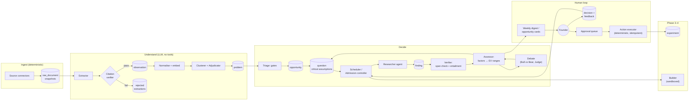

# 04 — Revised System Architecture

> Principles: **deterministic code orchestrates, LLMs judge.** Roles are prompts, not processes. Untrusted content is read only by components that cannot act. Every claim is mechanically traceable to a stored byte range.

---

## 1. Challenge to the 10-agent topology

v1.0 defines ten agents (A–J). Most of them are **a prompt plus an output schema**, not autonomous agents. Making them separate long-lived agents adds coordination overhead, creates more surface for loops, and lets agents "agree" with each other. The orchestrator (J) in particular should not be an LLM: scheduling, budgeting, deduplication, and gate enforcement are deterministic policies, and an LLM orchestrator is the most common source of runaway loops in agent systems.

### Role mapping

| v1.0 role | Revised implementation | Kind |
|---|---|---|
| A. Discovery Scouts | **Source connectors** (code) + **Extractor** (LLM, no tools) | Code + pure LLM function |
| B. Skill & Workflow Mapper | **Extractor** prompt variant + **Labour-market pipeline** (code + LLM rubric) | Pure LLM function |
| C. Problem Analyst | **Clusterer** (embeddings + algorithm) + **Adjudicator** (LLM, pairwise) | Code + pure LLM function |
| D. Market Researcher | **Researcher** agent, `market` / `competitor` question types | Agentic (tools) |
| E. Commercial Analyst | **Assessor**: LLM fills factor ranges with citations; **code** does the math | LLM function + code |
| F. Technical Feasibility | **Researcher** agent, `technical` question type; later **Prototype Builder** | Agentic |
| G. Adversarial Researcher | **Debate**: a Bull advocate and a Bear (red team), each a separate Claude session, argue from cited evidence; a fresh Judge session rules. All are blinded to scores (see §4.1) | Agentic |
| H. Validation Designer | **Assessor** sub-step: generates experiments from the weakest-link factor | LLM function |
| I. Prototype Builder | **Builder** (Phase 4 only): coding agent in a sandbox | Agentic, sandboxed |
| J. Orchestrator | **Scheduler / Admission Controller** (code) | Deterministic code |

Result: **4 LLM roles** (Extractor, Adjudicator, Assessor, Researcher with question-type variants), **1 adversarial process** (Debate: Bull / Bear / Judge), **1 later role** (Builder), and deterministic code for everything else.

### Separate workers or dynamic roles? (v1.0 Q3)

**Dynamic roles.** A single worker pool pulls typed tasks from the queue. Task type → (prompt template, tool allowlist, output schema, model choice, budget). There are no persistent per-role processes. The setup stays the same at 1 or 50 concurrent tasks.

---

## 2. Component diagram

### Component responsibilities

| Component | Input → Output | Notes |
|---|---|---|
| **Source connectors** | Source config → `raw_document` | One module per source. Incremental cursors, rate limits, ToS record, content hash, canonical URL. No LLM. |
| **Extractor** | `raw_document` → 0..n `observation` (JSON) | **No tools, no network.** Must return verbatim span offsets. Batched; cheap model tier is fine. |
| **Citation verifier** | observation/finding → pass/fail | Deterministic: `snapshot[start:end] == quote` after whitespace normalisation. Rejects extractions with missing or mismatched spans. |
| **Normaliser + embedder** | observation → normalised job statement + vector | Template: actor/segment, job, obstacle, consequence. |
| **Clusterer + Adjudicator** | vectors → problem hierarchy | ANN attach / LLM adjudicate ambiguous band / weekly density re-cluster (see `02` §6). |
| **Triage** | problem → opportunity (or not) | Runs the *cheap* gates (M1, M2, F1–F4) with available evidence; creates UNKNOWN questions. |
| **Scheduler / Admission controller** | questions, budgets, decisions → tasks | Code. Value-of-experiment ordering, budgets, dedupe, depth limits (see §5). |
| **Researcher** | question → findings | Agentic: web search + fetch + internal KB search. **Read-only tools.** Each finding must cite stored snapshots (fetched pages are snapshotted first). |
| **Verifier** | finding → verified / unsupported / contradicted | Span check (deterministic) + entailment check (LLM, different prompt): "Does this quote support this claim? yes/partial/no". |
| **Assessor** | verified findings → factor ranges, gates, EV distribution, weakest link, next experiments | LLM fills ranges with citations; **code** runs Monte Carlo and sensitivity. |
| **Debate** | dossier (minus scores) → rulings on contested claims, surviving objections, kill-questions | Bull and Bear are independent Claude sessions; a fresh Judge rules. The Bear is scored on *specific, evidenced* objections that later prove right. See §4.1. |
| **Reporter** | DB → markdown digest + cards | Templates, not free-form prose. |
| **Approval queue + Action executor** | approved action → external effect | The **only** component with external-write credentials. Idempotency keys. No LLM in the execution path. |
| **Builder** (Phase 4) | approved prototype spec → repo + tests + benchmark | Coding agent in an isolated container; no production credentials. |

---

## 3. Persistent memory model (summary)

Postgres is the single source of truth. Full schema is in `PRD.md` §8. Key design choices:

1. **Append-only snapshots.** `raw_document` stores the fetched content (or a pointer to an object-store blob) with a content hash. Every quote is checked against this. Re-fetches create new rows when the hash differs, which gives you change tracking and price-page diffs for free.
2. **Questions are first-class.** `question` rows carry the opportunity's critical assumptions: text, linked factor, current belief, status, VoE estimate, cost estimate. Research tasks *answer questions*. This gives research a natural stopping condition and audit trail.
3. **Events, not overwrites.** `decision` is an append-only log of state transitions, human feedback, and reasons. Opportunity state is derived from the latest decision.
4. **Versioned judgments.** Every LLM output row stores `model`, `prompt_version`, `input_hash`. Reanalysis with newer models (v1.0 requirement) means re-running a task type over stored inputs and diffing outputs.
5. **Corrections.** A human or verifier can mark a finding `retracted` with a reason. Dependent assessments are flagged stale and re-queued.
6. **Semantic search** via pgvector over normalised observations, problems, and findings. No graph DB: relationships are join tables (problem↔observation, opportunity↔problem, finding↔observation) and recursive CTEs cover the problem hierarchy.

---

## 4. Verification process

Defence in depth against AI-generated misinformation:

| Layer | Mechanism | Catches |
|---|---|---|
| 1 | **Span check**: every quote must exist verbatim in a stored snapshot | Fabricated quotes and sources (the most common failure) |
| 2 | **Entailment check**: separate LLM call judges whether the quote supports the claim, using an "overclaiming" rubric | Paraphrase inflation ("someone mentioned" → "users report") |
| 3 | **Tier assignment by rule**, not by the researcher: tier comes from source type + extraction category | Agents upgrading their own evidence |
| 4 | **Independence counting** in code | Echo chambers, syndication |
| 5 | **Structured debate** (Bull vs. Bear, fresh Judge), blinded to scores, uncited arguments struck | Correlated optimism |
| 6 | **Dual independent research** for opportunities entering validation: two Researcher runs with different seeds/models answer the same question set; disagreements become questions | Single-run variance, missed competitors |
| 7 | **Human spot-check**: the weekly review includes 3 randomly sampled findings for the founder to grade (30 seconds each) | Systemic drift; gives the precision metric |

### 4.1 Debate protocol (adversarial review, Claude-only)

The founder chose to use Claude for every role rather than a second provider. Adversarial review is therefore a **structured debate between independent Claude sessions**, not a single critic:

1. **Bull** (advocate) and **Bear** (red team) each start a *fresh session* with no shared context. Each gets the dossier's evidence and factor ranges, but **not** the EV, rankings or the other side's reasoning. Both have the same read-only research tools, so the Bear can go looking for the competitor or the free alternative.
2. **Round 1:** each side files up to 5 arguments. Every argument must cite stored snapshots (span-checked like any finding). The Bear works through a fixed checklist: a strong incumbent at the same price, a free or general-agent substitute, unreachable buyers, no spend evidence, unit cost above price, and a buyer who is not the user.
3. **Round 2:** each side sees the other's surviving arguments and files rebuttals, again with citations.
4. **Verifier pass:** arguments whose citations fail the span or entailment check are struck before judging.
5. **Judge** (a third fresh session) sees only the dossier facts and the verified arguments. It rules on each contested claim as *Bull holds / Bear holds / unresolved*. Its output is surviving objections, updated gate verdicts and new kill-questions. Unresolved claims become Questions.
6. **Bounds:** exactly 2 rounds and one Judge pass per dossier version. The debate re-runs only when the dossier's evidence materially changes.

**Caveat:** all three roles share one model's blind spots, so the debate reduces *process* bias (anchoring on the bull case, sycophancy toward a polished dossier) more than *knowledge* bias. The mitigations are mandatory citations, independent contexts, the Bear's checklist, and tracking which objections later proved right (`objection.later_outcome`). If the Bear's hit rate stays low, revisit the second-provider option.

---

## 5. Autonomy without loops

The system is autonomous because **the queue is regenerated from state**, not from conversation. Every night the scheduler asks: *given current opportunities, questions, budgets, and source freshness, what are the highest-value tasks?*

### Admission control rules (code)

1. **Every task references a question** (or a source collection job). No free-form "explore X" tasks.
2. **Dedupe key** = `(task_type, opportunity_id, normalised_question_hash, evidence_snapshot_version)`. If an equivalent task completed against the same evidence, it is not re-admitted.
3. **Earned budgets.** Each opportunity has a research budget (agent turns and tool calls) that **grows with evidence tier**: e.g., Discovered: 1 unit; passes cheap gates: 5; has T1/T2 evidence: 20; in validation: 50. Weak ideas can't consume deep research.
4. **Bounded delegation.** Agents may *propose* follow-up questions (max 3 per task). The admission controller accepts them only if they pass dedupe, are linked to a factor, and fit the budget. Max proposal depth = 2 from a human- or triage-originated question.
5. **Information-gain stopping.** After each research task, the Assessor records whether any factor's range or gate status changed. **Two consecutive tasks on an opportunity with no material change** (no range narrowed by > 20%, no gate flipped) → the opportunity's desk research is marked *saturated*. Further progress requires an external experiment, which is escalated to the human.
6. **Retry policy.** Max 2 retries with backoff; failures go to a dead-letter table and appear in the digest's "blocked" section.
7. **Collection freshness.** Sources are fetched on their configured cadence *only*. A source whose last N fetches produced no new observations is automatically backed off (cadence doubles, up to a cap).
8. **Global caps.** Max concurrent agent tasks, max agent turns per day (sized to the subscription's rate limits), max browser sessions, and a $ cap for any paid data source. Exceeding a cap pauses admission, not the system.

---

## 6. Orchestration options compared (v1.0 Q2)

| Option | Pros | Cons | Verdict |
|---|---|---|---|
| **Postgres-backed job queue** (`SELECT … FOR UPDATE SKIP LOCKED`, or a library on top of it) + cron | One dependency (Postgres, already needed); transactional enqueue with domain writes; trivial to inspect with SQL; easy local dev | You implement retries and schedules yourself (small); no built-in workflow history UI | **Recommended for MVP–Phase 3** |
| **Temporal** | Durable long-running workflows, signals for human approvals, excellent retries and visibility; you already know it | Extra server and persistence to operate; determinism constraints on workflow code; overkill for "fetch → extract → store" | **Adopt in Phase 3–4 if** validation and prototype workflows with multi-week waits and many human signals become painful in the queue model |
| Agent-framework orchestration (LLM-driven planners) | Fast demos | Non-deterministic control flow, loops, hard to budget and debug | **Reject** for control plane; fine *inside* a bounded Researcher task |
| Cloud workflow services | Managed | Vendor lock-in, cost, slower local iteration | Not needed |

**Switch criterion to Temporal:** more than ~3 workflow types with human-signal waits > 1 day, *or* you find yourself writing a workflow-state machine in SQL with compensation logic. The task/queue table design should keep this switch cheap: tasks are idempotent, with explicit inputs and outputs.

---

## 7. Recommended stack (one engineer + AI coding agents)

**Founder decisions applied:** Go as the language; Claude for every model role, run on the founder's Claude Enterprise subscription, which the founder confirms allows unattended 24/7 use.

| Concern | Choice | Rationale |
|---|---|---|
| Language | **Go** (1.24+) for everything: connectors, pipeline, scheduler, CLI, tool server | Founder's strongest language, so review is fast and the code stays maintainable. The data-science gaps (clustering, Monte Carlo) are small enough to write directly (see rows below). |
| Database | **PostgreSQL 16+ with pgvector** (`pgx` driver, plain SQL + `sqlc`) | Single store for snapshot metadata, entities, queue, vectors, ledgers |
| Queue | Postgres `SKIP LOCKED` table (or River, a Go job queue on Postgres) | See §6 |
| Scheduling | A single scheduler loop process (or system cron) | Nightly and weekly jobs; event triggers are queue inserts |
| LLM access | **Claude Code in headless mode (`claude -p`) run as a subprocess** from a Go `claude` package, authenticated with the subscription (see §7.1) | No official Go Agent SDK exists, and the Go Messages-API SDK is for metered API keys. Headless Claude Code is the supported route for other languages, and it brings the agent loop, WebSearch and structured output with it. |
| Structured output | `--output-format json --json-schema <schema>`; the Go side validates `structured_output` again and treats a missing value as a failed task | Schema-constrained extraction without a custom tool loop |
| Custom tools | A **local MCP server written in Go** (the official MCP Go SDK) exposing `fetch_and_snapshot`, `kb_search`, `propose_question`, passed with `--mcp-config` and `--strict-mcp-config` | Keeps tools read-only and under our control |
| Web search | Claude Code's built-in **WebSearch** | Included with the subscription; no separate search API. *Week-1 check:* confirm it is available under subscription auth in headless mode, and fall back to a paid search API behind the same MCP server if it isn't. |
| Web fetch | **Our own `fetch_and_snapshot` MCP tool**, not the built-in WebFetch | The built-in WebFetch passes pages through a separate model call, so its output is a summary, and verbatim span checks need the raw page. Disable WebFetch for every task. |
| Embeddings | A **local open-source embedding model** served over HTTP (e.g., via Ollama or a text-embeddings server), called from Go | Claude does not provide embeddings; a local model costs nothing per call and keeps vectors stable. Pin the model and store `embedding_model` per vector. |
| Clustering | pgvector ANN attach + LLM adjudication (online); weekly **agglomerative clustering** over normalised statements, implemented in Go | Avoids a Python dependency; at tens of thousands of observations a straightforward implementation is fast enough |
| Monte Carlo | Plain Go (`math/rand/v2`, triangular sampling, ~10k draws) | Milliseconds; no library needed |
| Blob storage | Local filesystem (content-addressed by hash) → S3-compatible later | Snapshots can be large |
| Reports | Markdown files committed to a private git repo (or a notes app) + email/chat notification | No dashboard needed for MVP |
| Ad-hoc exploration UI | **Metabase** (or Datasette) over Postgres, read-only | Evidence navigation and filtering for free; runs as a container, so no Python in the codebase |
| Evaluation analysis | SQL views + `aoe eval` CLI reports | Keeps one language; a notebook is optional for one-off analysis |
| Approvals | CLI (`aoe approve <id>`) + optional chat-bot buttons | Simple, auditable |
| Sandboxing (Phase 4) | Rootless containers, no credentials mounted, network egress allowlist (package registries only), CPU/mem/time limits; consider gVisor/Firecracker if running untrusted third-party code | v1.0 Q14 |
| Observability | Structured JSON logs (`log/slog`); `task` and `llm_call` tables *are* the metrics (turns, estimated cost, latency, outcome); a few SQL views | No Prometheus/Grafana until there is a service to monitor |
| Deployment | Single VM or home server with `docker compose` (Postgres, worker, scheduler, embedding server, Metabase) | You can move it to Kubernetes later; there's no reason to start there |

**Deliberately not used initially:** Kubernetes, Temporal, Kafka, graph DB, vector DB separate from Postgres, React dashboard, multi-provider routing gateways, LangChain-style orchestration frameworks, a second model provider.

### 7.1 Driving Claude from Go

All model calls go through one Go package with two functions, `Complete(taskType, prompt, schema)` and `RunAgent(taskType, prompt, tools, limits)`. Both build a `claude -p` command line from the task type's config:

| Setting | Extraction / adjudication / judging (no tools) | Research / debate (tools) |
|---|---|---|
| Output | `--output-format json --json-schema <schema>` | same |
| Built-in tools | `--tools ""` (none) | `--tools "WebSearch"` |
| Allowed tools | none | `--allowedTools "WebSearch,mcp__aoe__fetch_and_snapshot,mcp__aoe__kb_search,mcp__aoe__propose_question"` |
| MCP | `--strict-mcp-config` with an empty config | `--mcp-config aoe-mcp.json --strict-mcp-config` |
| Permissions | `--permission-mode dontAsk` (anything not pre-approved is denied) | same |
| Limits | `--max-turns 3` | `--max-turns` from the task's research budget |
| Model | `--model <alias from config>` | same |
| Prompt | `--system-prompt-file prompts/<task>/<version>.md` | same |
| Session | `--no-session-persistence` (every task starts fresh) | same; debate roles are separate processes by construction |

Operational rules:

1. **Authentication.** Run `claude setup-token` once and give the worker the token as `CLAUDE_CODE_OAUTH_TOKEN`. The worker environment must **not** contain `ANTHROPIC_API_KEY`, `ANTHROPIC_AUTH_TOKEN`, an `apiKeyHelper`, or cloud-provider switches: any of these silently takes precedence and moves the calls to metered API billing. Don't use `--bare`, which ignores the subscription token.
2. **Health check.** `claude auth status` runs on worker start and hourly; it must report the OAuth token method. The token lasts about a year, so the digest warns 30 days before expiry.
3. **Pin versions.** Pin the Claude Code version in the worker image, because several flags are version-gated. Upgrade deliberately, re-running the evaluation suite (`07` §8).
4. **Fixed working directory.** Run every call from an empty, dedicated working directory, so no repository hooks, `CLAUDE.md` or `.mcp.json` leak into tasks.
5. **Parse defensively.** Read stdout even on a non-zero exit; treat a missing `structured_output` as a failure; retry rate-limit errors with backoff (subscription plans have rate limits even when there's no per-call cost).
6. **Timeouts.** Send SIGINT at the task deadline, then SIGKILL after a grace period.
7. **Usage logging.** Record turns, duration and the CLI's `total_cost_usd` in `llm_call`. Under the subscription that figure is an *estimate*, not a bill, but it is still the right unit for comparing pipeline variants and for cost-per-opportunity metrics.

---

## 8. Security model

Treat all collected content as hostile (prompt injection is the main threat):

1. **Capability separation.** Components that read untrusted text (Extractor, Researcher, Debate roles, Adjudicator) have **no write tools to the outside world and no credentials**. The only external-write component (Action executor) runs deterministic code on human-approved, structured action records. It never runs on LLM free text.
2. **Structured outputs only.** LLM outputs are parsed against JSON schemas. Fields that will be shown to the human are rendered as text, never executed or followed as instructions.
3. **Injection canaries.** Flag snapshots containing instruction-like patterns directed at AI systems. Extracted observations from such content are tagged and down-weighted, and the Debate's Bear and Judge are told about them.
4. **Secrets.** API keys live in the worker environment, not in prompts or tool outputs. Search/fetch tools are implemented server-side with keys injected by code.
5. **Egress controls.** Fetch tools enforce a denylist (internal networks, metadata endpoints) and per-domain rate limits.
6. **Personal data minimisation.** Store author handles only when needed for independence counting. Hash them where possible, and never build profiles of individuals. Prospect lists contain **organisations and public business contact paths**, not personal data beyond what is needed.
7. **Prototype sandbox** as in §7; no production credentials anywhere in Phase 4 builders.

---

## 9. Model strategy

All roles use Claude, selected per task type with `--model` aliases in config, so newer models can be adopted without code changes.

| Task | Model tier | Why |
|---|---|---|
| Extraction, normalisation | Fast tier (e.g., `haiku`) | High volume, schema-constrained |
| Dedupe adjudication | Mid tier (e.g., `sonnet`) | Pairwise judgments, moderate volume |
| Research agent | Top tier (e.g., `opus`) | Long-horizon tool use, synthesis |
| Assessor | Top tier | Judgment with citations |
| Debate (Bull, Bear, Judge) | Top tier, three independent sessions | Reduce process bias; see §4.1 |
| Pairwise ranking | Top tier, both orders | Position-bias cancellation |
| Embeddings | Local open-source model, pinned version | Changing it requires re-embedding; store `embedding_model` on every vector |

Even without a per-call cost, record the turns and estimated cost of every call in `llm_call`. Throughput is bounded by the plan's rate limits and by worker concurrency, so the scheduler's caps are expressed in **concurrent tasks and turns per day**, not dollars.
