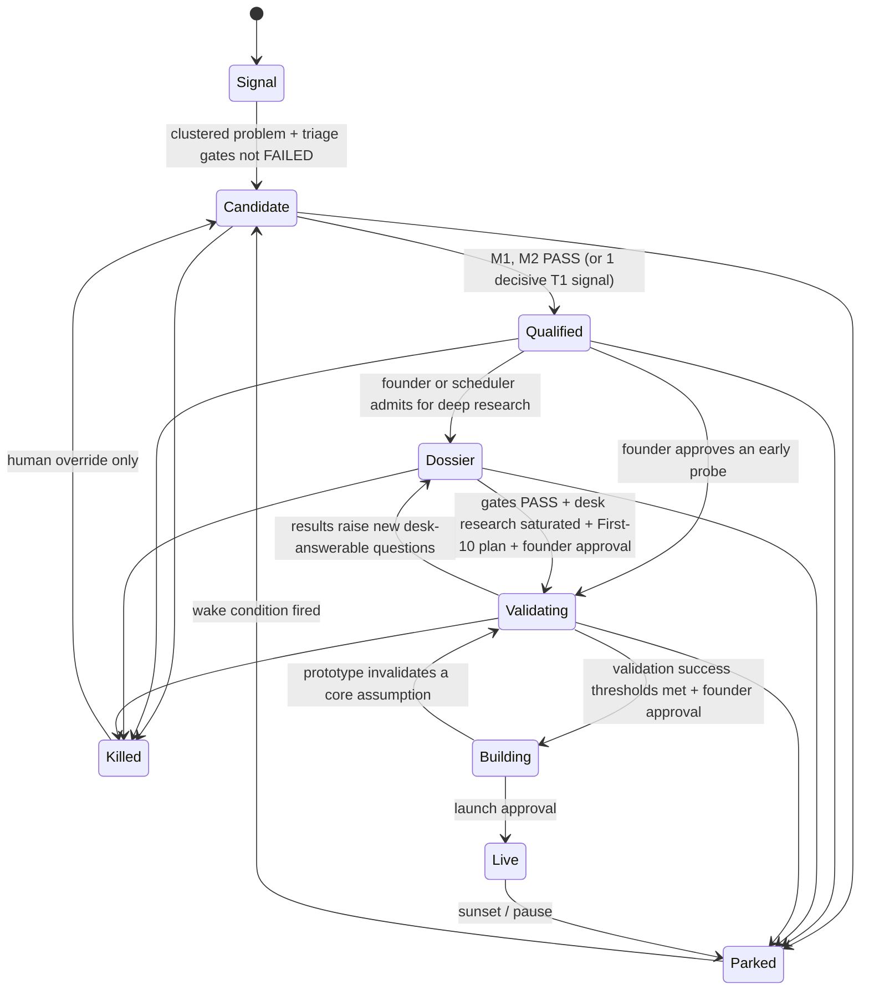

# 05 — Revised Opportunity Lifecycle

> Principles: **kill cheaply, early, and in the right order.** Every stage has an entry gate, a budget, an exit artefact, and pre-committed kill criteria. Customer contact moves earlier. Adversarial review is continuous rather than a one-off stage.

---

## 1. What changes from v1.0

| v1.0 | Revised | Why |
|---|---|---|
| 8 linear stages | 6 stages + 3 terminal/holding states | Fewer handoffs; adversarial review folded into every stage |
| Adversarial review is Stage 4, after deep research | Red-team **kill questions run first** in every stage | Cheapest disconfirming checks first. Deep research on an idea that a 10-minute competitor search would kill is waste |
| Customer validation at Stage 5 | A **5-conversation probe** is allowed as soon as an opportunity is *Qualified* | Five conversations often beat any amount of desk research |
| "Opportunity" fixes a solution | An opportunity is a **problem × segment**; solutions/paths are evaluated inside it | Keeps optionality (service-first, plugin, SaaS, acquire) |
| Rejected / Paused / Reopened states | **Killed** (reason code) and **Parked** (with machine-checkable *wake conditions*) | Reopening becomes automatic and auditable |
| No budgets per stage | **Earned research budget** per stage | Prevents weak ideas from consuming deep research |

---

## 2. States

### Stage definitions

| Stage | Entry gate | Research budget (units) | Exit artefact | Typical kill reasons |
|---|---|---|---|---|
| **Signal** | ≥ 1 verified observation | 0 (extraction only) | Clustered problem | n/a (signals are not opportunities) |
| **Candidate** | Problem with ≥ 2 independent origins (see PRD OPP-1 for why a single T1 observation no longer qualifies) | 1 | Triage card: gates F1–F4, M1, M2 status; 3–5 critical questions | F-gate fail; no identifiable buyer after triage |
| **Qualified** | M1 + M2 PASS | 5 | Kill-question results (competitor sweep, prospect-list feasibility, unit-cost sanity) | Strong incumbent at same price/segment; < 50 prospects findable; unit cost > price |
| **Dossier** | Qualified + admitted by scheduler (VoE ranking) or founder | 20–50 | **Opportunity dossier**: factor ranges, EV distribution, 3 paths, First-10 plan, red-team report, pre-registered predictions, validation plan | Gates fail on evidence; P(MRR ≥ $1k) below threshold; desk research saturated with weakest link unresolvable cheaply → go to Validating or Park |
| **Validating** | Founder approval of a specific experiment | External: founder hours + $ cap set per experiment | Experiment results + updated factors + Brier-scored predictions | Pre-committed kill thresholds hit |
| **Building** | Success thresholds met (e.g., ≥ 2 paid commitments or ≥ 3 strong pilots) + approval | Prototype budget (time-boxed) | Working prototype that tests the *riskiest technical assumption*; then MVP | Critical workflow quality/cost not achievable |
| **Live** | Launch approval | Ops budget | Metrics: activation, paid conversion, retention, support load, margin | Below retention/margin floor after N months |

### Holding / terminal states

- **Parked**: not now, but plausibly later. **Must** carry ≥ 1 wake condition in machine-checkable form:
  - `capability`: e.g., "document-extraction benchmark cost < $X per page" (checked when the model registry is updated)
  - `evidence_count`: e.g., "≥ 3 new independent T4+ observations for problem P"
  - `competitor_event`: e.g., "price change or shutdown detected for competitor C"
  - `regulation`: e.g., "rule R reaches final-rule status"
  - `date`: re-review after date D
- **Killed**: reason code from a fixed taxonomy (`no_buyer`, `no_spend`, `unreachable`, `incumbent_strong`, `negative_margin`, `infeasible`, `founder_gate`, `invalidated_by_experiment`, `founder_veto`, `out_of_scope`) plus free-text and evidence links. Only the human can revive a killed opportunity.
- **Awaiting approval** is not a stage. It is a flag on any task or experiment, shown in the approval queue.

---

## 3. Kill-first ordering inside each stage

Within a stage, the scheduler orders that stage's questions by **P(kill) ÷ cost**, highest first. Typical kill questions are listed cheapest-first:

1. **Competitor sweep** (≈ minutes): is there an incumbent with a strong rating that already serves *this segment* at a comparable price?
2. **Prospect-list feasibility** (≈ minutes): can we find 50 named organisations in this segment with public contact paths?
3. **Unit-cost sanity** (≈ minutes): does running the core workflow on a sample input with current models cost < 40% of the plausible price?
4. **Spend evidence** (≈ tens of minutes): can we find T1–T3 evidence that this buyer spends on this job today?
5. **Founder gates** (founder: seconds): any licensing or solo-operability conflict? (The F1 employment check is optional and currently disabled.)

Only after these do the expensive questions run: market sizing, channel research, defensibility analysis, technical deep-dive.

---

## 4. Transition rules in detail

### Qualified → Validating (early probe)

Allowed when **all** hold:

- M1 and M2 PASS.
- A prospect list of ≥ 20 organisations exists (≥ 50 required before scaled outreach).
- The probe is cheap: ≤ 3 founder-hours, $0–$50.
- The founder approves.

Typical probe: 5 problem-interview requests to prospects, or 1 public question in a community where the founder participates credibly, with approval.

### Dossier → Validating (v1.0 Q15: when to move from research to customer validation)

Move when **desk research is saturated**, meaning the top-VoE remaining question can only be answered by a human or the market, **and**:

- All gates PASS (no FAIL, no UNKNOWN on M1–M3).
- P(MRR ≥ $1k at 12m) ≥ a configurable threshold (start at 0.15 and tune).
- First-10 plan complete (≥ 50 prospects, primary channel, founder-executability answers).
- Validation plan with **pre-registered success and kill thresholds**.

In practice this should usually happen **within 1–2 weeks** of entering Dossier. Long dossier phases are a smell.

### Validating → Building

Requires **behavioural** evidence, ranked from strongest to weakest:

1. ≥ 2 paid commitments (pre-order, paid pilot, deposit).
2. ≥ 1 paid concierge customer + ≥ 3 more in active pilot conversations.
3. ≥ 3 prospects who complete a workflow demo *and* agree to a priced follow-up.

Signups, likes, "I'd use that", and landing-page visits are **not** sufficient alone.

### Any → Parked/Killed

Each transition writes a `decision` row with actor (human/system), reason code, evidence links, and the factor snapshot at the time. That snapshot lets the system later audit its own judgments: "we killed X for `incumbent_strong`; a year later, did X's incumbent hold?"

---

## 5. Validation experiment catalogue

Ordered by signal strength per unit of founder time:

| Experiment | Measures | Founder time | Signal strength | Approval |
|---|---|---|---|---|
| Problem interviews (5–10) | Problem reality, current spend, buyer role | 3–6 h | Medium–High (T2) | Yes (outreach) |
| Concierge offer ("I'll do this for you for $X this month") | WTP, delivery cost, edge cases | 4–20 h | **High (T0)** | Yes |
| Priced pre-order / paid pilot | WTP at price | 2–6 h | **Highest (T0)** | Yes |
| Workflow demo on prospect's own (sample/public) data | Value perception, data realities | 2–4 h | Medium–High | Yes |
| Marketplace "coming soon" listing / waitlist | Organic marketplace demand | 1–2 h | Medium (T5→T1 once paid) | Yes (public) |
| Priced landing page + targeted traffic | Click-to-checkout intent | 2–4 h + ad $ | Low–Medium | Yes ($) |
| Community question | Problem prevalence, vocabulary | 0.5–1 h | Low–Medium | Yes (public) |

Each experiment record contains: hypothesis, linked factor(s), method, sample, **pre-registered predictions with probabilities**, success threshold, kill threshold, budget cap, results, Brier score, conclusion, and the resulting decision.

The system *prepares* every experiment end to end (prospect list, personalised drafts, interview guide, landing copy, tracking). The founder approves and sends. The system then ingests results (transcripts, replies, payments) as T0/T2 evidence.
